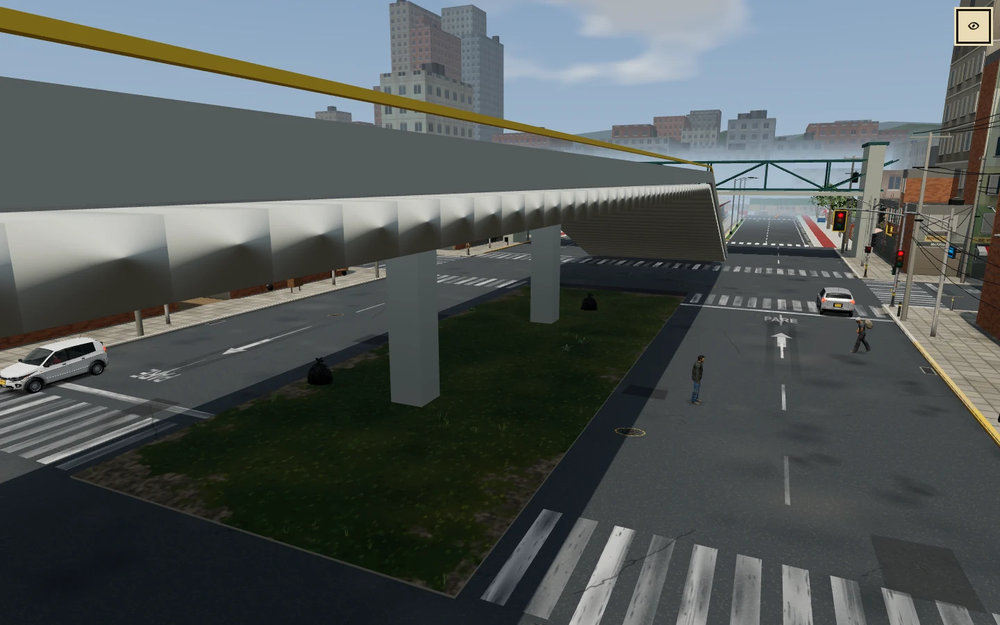

# Cambios principales de BAZUKO

12 capturas reales, dos por cada uno de los seis temas principales. Tomadas el 1 de noviembre de 2026 en Chromium sobre el código `fe7c7f725c8db46440758c21d6730777d78ded84`, convertidas a WebP para reducir su peso.

Las escenas se prepararon en sesiones locales aisladas. Las capturas de sala se identifican en cada apartado; las imágenes no son mediciones de FPS ni pruebas en dispositivos físicos o producción.

## 1. Interfaz de cartón y marcador

HUD, radar, menús, creador, mapa, inventario y fabricación con letra propia y distribución adaptable.

| HUD de escritorio | Costal de escritorio |
| --- | --- |
|  |  |

## 2. Ciudad y barrios de Bogotá

Materiales, edificios, vegetación y ampliación oriental con La Candelaria y Chapinero-Teusaquillo.

| Plaza de La Candelaria | Teusaquillo y torres |
| --- | --- |
|  |  |

## 3. Vehículos y transporte público

Flota bogotana, taxis, motos, articulados y Portal del Centro; correcciones de tráfico, cruces y acceso peatonal. El taxi se muestra en la sala de pruebas.

| Taxi y flota | Portal del Centro |
| --- | --- |
|  |  |

## 4. Personajes, peatones y animaciones

Piel, ropa, accesorios, arquetipos y locomoción. Ambas capturas corresponden a la sala de pruebas.

| Variedad de peatones | Caminar en la sala |
| --- | --- |
|  |  |

## 5. Combate y natación

Golpes y reacciones en la partida, armas y combos; entrada al lago, flotación, estela y regreso a la orilla.

| Golpe y reacción | Natación en el lago |
| --- | --- |
|  |  |

## 6. Gráficos del escenario en escritorio

Dos vistas de la ciudad 3D: avenida con pavimento, señalización, edificios y viaducto; parque con agua, ribera, vegetación y ambiente de lluvia. Ambas capturas son de escritorio a 1440 × 900.

| Avenida y detalles urbanos | Parque, lago y viaducto |
| --- | --- |
|  |  |
